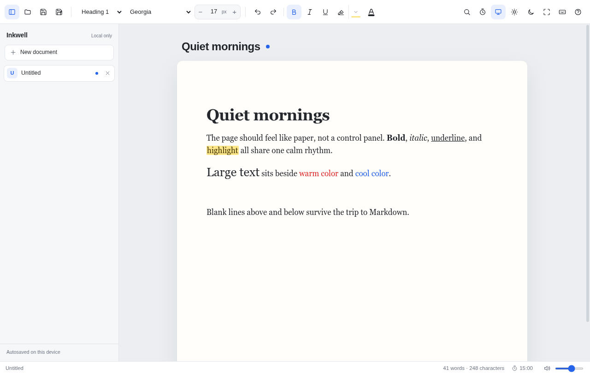

# Inkwell

A small desktop writing app: rich text on the surface, Markdown on disk. Tabs,
find/replace, distraction-free and typewriter modes, synthesized key sounds, a
timer with word tracking, and lossless round-trips for the formatting it
supports.

Everything runs offline. There are no accounts, telemetry, or network requests
at runtime.



## Stack

**Tauri 2 + hand-written TypeScript, HTML, and CSS.** No frontend framework and
no bundler.

- Tauri uses the operating system's web view instead of shipping Chromium, so
  the install and memory footprint stay small and startup is fast. The native
  layer is Rust, which also provides the open/save dialogs and file IO.
- Vanilla DOM code keeps the app a few thousand lines with no build step beyond
  `tsc`. There is no virtual DOM, hydration, or client-side router to start up.
- Native `contenteditable` editing gives per-tab undo history for free. Each tab
  owns a separate editor element; switching tabs does not destroy its undo stack.

Runtime npm dependencies: **none**. The two vendored libraries are copied into
`ui/vendor` at install time:

| Library | Why it is here |
| --- | --- |
| [`marked`](https://github.com/markedjs/marked) | Markdown parsing. Hand-writing a CommonMark parser would be far more code and much easier to get wrong on links, nested lists, code fences, and inline emphasis. A small custom extension adds `==highlight==`. |
| [`DOMPurify`](https://github.com/cure53/DOMPurify) | Sanitizes Markdown-generated HTML, imported files, and pasted HTML. This is a security boundary; a hand-rolled allow-list is not worth the risk. |

`jsdom` is used only by the test runner. `@tauri-apps/cli` and `typescript` are
build tools.

## Requirements

- Node.js 20+ and npm
- Rust (stable) and Cargo
- Tauri's Linux prerequisites for your distribution (WebKitGTK 4.1, GTK 3,
  `libappindicator`, `librsvg`, etc.)

On Arch the relevant packages are already present in a normal desktop
install. See the [Tauri prerequisites](https://v2.tauri.app/start/prerequisites/)
for other distributions.

## Setup, run, build

```sh
git clone https://github.com/Rjbanti420/inkwell.git
cd inkwell
npm install          # installs dev tools and vendors marked + DOMPurify
npm run dev          # build TypeScript, then launch the desktop app with hot reload
npm run build        # release build plus .deb and AppImage bundles
npm run build:app    # release binary without packaging
npm test             # TypeScript build + Markdown and word-tracking tests
```

The debug binary is `src-tauri/target/debug/inkwell`; the release binary is
`src-tauri/target/release/inkwell`.

If `ui/vendor` is missing, run `npm run vendor` (this also runs automatically
after `npm install`).

## Install on Linux

The release build produces a standalone binary, a `.deb`, and an AppImage under
`src-tauri/target/release/bundle/`. To install for the current user without
root:

```sh
npm run build
./install.sh
```

That copies the binary to `~/.local/bin/inkwell`, installs the icons and
`~/.local/share/applications/dev.inkwell.editor.desktop`, registers the app as a
handler for `text/markdown`, and refreshes the launcher and icon caches. Launch
“Inkwell” from the app launcher, or open a Markdown file with it. Markdown is the
default handler; Inkwell also appears under “Open With” for plain text, which
covers `.md` files that a tool reports as `text/plain`.

Uninstall only the launcher entry, icon, and binary:

```sh
./install.sh uninstall
```

The app's autosaved workspace is kept. Remove it manually with
`rm -rf ~/.local/share/dev.inkwell.editor` if you want a clean slate.

`inkwell path/to/note.md` opens that file; the desktop entry uses `%F`, so
right-clicking one or more `.md` files and choosing Inkwell works.

### Arch package

After `npm run build`:

```sh
cd packaging
makepkg -f
sudo pacman -U inkwell-bin-0.1.0-1-x86_64.pkg.tar.zst
```

The package installs `/usr/bin/inkwell`, the desktop entry, and the icons
system-wide. The user-level `install.sh` is independent of this package.

## Features

- A vertical document sidebar with per-tab undo, filename, dirty dot,
  double-click or F2 rename, hover close, drag reorder, and a warning before
  closing a tab with unsaved changes. Collapse it with the toolbar button or
  `Ctrl+\`; drag its right edge to resize, double-click the edge to reset, and
  both the width and collapsed state are remembered.
- A File menu for Open and Save As, and a Settings menu for page width,
  typewriter mode, full-screen, and the shortcut sheet. Save stays on the
  toolbar.
- Autosave of the whole workspace to `localStorage` (debounced 400 ms, plus a
  save on tab switch and before unload). All tabs, titles, file paths, dirty
  state, and content are restored on the next launch. Disk files are only
  written when you save.
- Bold, italic, underline, and a highlight toggle with a small color picker
  (yellow by default, plus “No highlight”). Highlighting composes with the other
  inline styles instead of replacing them.
- Normal/H1/H2 paragraph styles; undo/redo.
- Bullet and numbered lists (`Ctrl+Shift+8` / `Ctrl+Shift+7`) with `Tab` /
  `Shift+Tab` nesting, active toolbar state, and inline formatting that carries
  to the next item. `Enter` on an empty item leaves the list; `Backspace` at the
  start of an item removes its bullet without losing the text.
- Font family (11 families with previews), font size (8–200 px; buttons, numeric
  input, `Ctrl+=` / `Ctrl+-`), and font color (presets and custom picker). Styles
  apply to the selection, or become the typing style at the caret when nothing is
  selected. “Default (auto)” removes the inline color so text follows the theme.
- Toolbar state tracks the caret, so size, color, and bold/italic/underline
  indicators show what is actually at the selection or insertion point.
- Selecting text raises a small floating formatting bar (bold, italic,
  underline, highlight, bullet list) above the selection; clicking it keeps the
  selection, and its pressed states mirror the main toolbar.
- Polished Light, Dark, and System themes with a toolbar switch and persisted
  choice. The default text color is automatic rather than a fixed black/white,
  and highlighted text stays readable in both themes.
- Find/replace with next/previous, replace, replace all, match case, live match
  counts, and all-match highlighting.
- Live word and character counts, plus counts for the current selection.
- Countdown or stopwatch timer with optional net-words-written tracking, elapsed
  time, WPM, and a session summary. The countdown finishes automatically.
- Distraction-free mode (F11 or toolbar): centered column, chrome fades in when
  the pointer reaches the top or bottom edge, Esc exits.
- Typewriter mode (`Ctrl+Shift+T`): distraction-free layout and typewriter
  scrolling. Web Audio-synthesized key clicks (letters, numbers, punctuation,
  Space, Backspace, Delete, Tab) and a distinct Enter bell/carriage sound work in
  every view, not only typewriter mode; Mute and volume controls live in the
  status bar.
- Click below the last line or press `Down` at the end to create empty lines;
  clicking an empty line places the caret there instead of at the end of the
  document.
- Light, dark, or system theme from the toolbar; the choice is remembered.
- Native open/save dialogs in the desktop app. Drag a `.md`/`.txt` file onto the
  window to open it.
- Sanitized imports and pastes; no remote content is loaded.

## Keyboard shortcuts

Press `Ctrl+/` in the app for the built-in cheat sheet.

| Shortcut | Action |
| --- | --- |
| `Ctrl+T` / `Ctrl+W` | New tab / close tab |
| `Ctrl+\` | Show / hide the document sidebar |
| `F2` | Rename the current tab |
| `Ctrl+Tab`, `Ctrl+PageDown` | Next tab |
| `Ctrl+Shift+Tab`, `Ctrl+PageUp` | Previous tab |
| `Ctrl+1…9` | Jump to tab |
| `Ctrl+O` / `Ctrl+S` / `Ctrl+Shift+S` | Open / save / save as |
| `Ctrl+B` / `Ctrl+I` / `Ctrl+U` | Bold / italic / underline |
| `Ctrl+Shift+H` | Highlight |
| `Ctrl+Shift+8` / `Ctrl+Shift+7` | Bullet / numbered list |
| `Tab` / `Shift+Tab` (in a list) | Indent / outdent list item |
| `Ctrl+Alt+0` / `1` / `2` | Normal / H1 / H2 |
| `Ctrl+=` / `Ctrl+-` | Increase / decrease font size |
| `Ctrl+Z` / `Ctrl+Shift+Z` | Undo / redo |
| `Ctrl+F` / `Ctrl+H` | Find / find and replace |
| `Enter` / `Shift+Enter` (in find) | Next / previous match |
| `F11` | Distraction-free mode |
| `Ctrl+Shift+T` | Typewriter + distraction-free mode |
| `Alt+T` | Timer panel |
| `Ctrl+Shift+M` | Mute key sounds |
| `Esc` | Close find/modal or leave distraction-free mode |

## Markdown mapping

Import parses Markdown with `marked`, sanitizes the result with DOMPurify, then
keeps only the inline styles the editor understands. Export walks the editor DOM
and writes CommonMark where possible.

| Editor formatting | Markdown / HTML on disk |
| --- | --- |
| Bold | `**text**` |
| Italic | `*text*` |
| Underline | `<u>text</u>` |
| Highlight | `==text==` |
| Heading 1 / 2 | `# text` / `## text` |
| Font color, size, family | `<span style="color:#e11d2e;font-size:18px;font-family:Georgia">text</span>` |
| Strikethrough (imported) | `~~text~~` |
| Link | `[label](href)` |
| List, quote, code fence, rule | `-`, `>`, fenced code, `---` |
| Local `data:` image | `` |

Supported styles survive import → export → import unchanged. Unsupported inline
wrappers are unwrapped rather than deleted, so text is never lost. Extra blank
lines are kept as blank paragraphs, and a single line break inside a paragraph
is written as a Markdown hard break (two trailing spaces). Nested list
indentation is written with two spaces per level; on import, indentation is
only widened where CommonMark requires it (for example under `1. ` items), so
the two-space form round-trips unchanged.

The round-trip tests assert this for a mixed document, inline styles, legacy
color shorthand, sanitization, many consecutive blank lines, hard breaks,
leading spaces, and nested lists.

## Tests

```sh
npm test
```

- `tests/markdown.test.mjs`: round-trip stability, text preservation, inline
  style import/export (including styles on `<b>`/`<u>` rather than `<span>`),
  legacy color normalization, script/event-handler sanitization, image
  handling, and fixture-based save/reopen checks for many blank lines, hard
  breaks, leading spaces, and mixed/nested formatting.
- `tests/words.test.mjs`: word/character/selection counts, net-new-word
  tracking (including deletions), zero-elapsed WPM, and duration formatting.

The UI was also exercised end-to-end in Chromium and WebKitGTK: typing and
autosave, selection-only and caret typing styles, size/color indicator sync,
highlight toggling with bold/italic intact, find/replace, the vertical sidebar
and `Ctrl+\`, tab rename, drag reorder, light/dark/system themes, the cheat
sheet, undo/redo, stopwatch and countdown summaries, distraction-free/typewriter
modes, Markdown drag-and-drop and export, and session restore.

## Known limitations

- Workspace autosave uses `localStorage`, which typically caps out around 5 MB
  per origin. Very large documents (especially ones with embedded `data:` images)
  may fail to autosave; saving to disk still works, and a toast warns you.
- Autosave is debounced by 400 ms, so a hard crash can lose the last few
  keystrokes. Closing a dirty tab asks first; closing the window relies on the
  workspace autosave.
- Only inline styles on inline elements map to Markdown. Block-level styling
  pasted from word processors is dropped (content kept).
- Tables are flattened to their text, task-list checkboxes are not interactive,
  and code-fence language classes are not preserved.
- Images are kept only when they are `data:` URLs, to honor the offline promise;
  remote images are replaced by their alt text.
- Clicking a link in the editor shows its URL in a toast instead of opening a
  browser, keeping the app fully offline.
- Find highlighting uses the CSS Custom Highlight API. On an old WebKitGTK
  without it, search, counts, replacement, and match navigation still work; only
  the painted highlight is missing.
- The preset text colors are mid-tone so they stay legible on both light and
  dark pages. A custom color that is near-black or near-white can still be low
  contrast in the opposite theme; “Default (auto)” always follows the theme.
- The editor writes Markdown; it is not a full CommonMark source editor. Unknown
  Markdown constructs are normalized to their text or the nearest supported
  formatting.

## License

MIT. See [LICENSE](LICENSE). Copyright (c) 2026 Rjbanti420.
